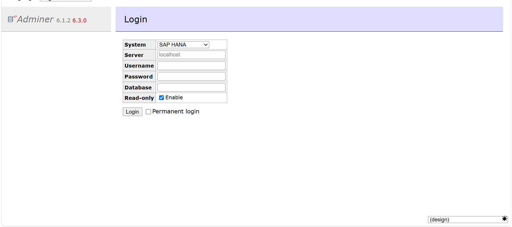
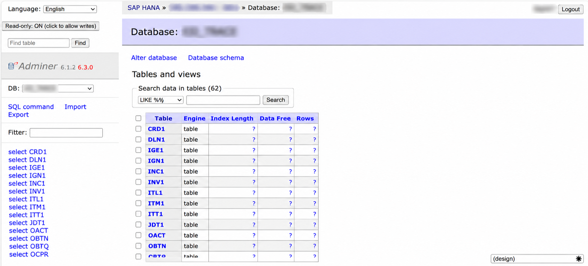

# Adminer SAP HANA

An Adminer 5/6 **database driver plugin** for [SAP HANA](https://www.sap.com/products/technology-platform/hana.html),
connected through PHP **PDO_ODBC** and the SAP **HDBODBC** client.

It is a single PHP file with no build step. Optional **read-only** mode is on by default
and can be toggled from the login form (HANA only) or from the navigation bar after login.

## Screenshots

Login — System = SAP HANA, Read-only checked by default:



After login — schemas as databases, table list, Read-only toggle in the sidebar:



## Features

- **SAP HANA** appears in Adminer’s System dropdown next to MySQL, PostgreSQL, etc.
- Connect with `host:port`, an ODBC DSN name, or a full ODBC connection string.
- Schemas are listed as Adminer databases; tables and views come from `SYS.TABLES` /
  `SYS.VIEWS`.
- Browse data, run SQL, inspect columns and primary/unique constraints (MVP).
- **Read-only (default ON)**
  - Checkbox on the login form, visible **only** when System = SAP HANA.
  - Toggle button in the sidebar after login.
  - Blocks write SQL (`INSERT` / `UPDATE` / `DELETE` / DDL / …) and UI edit paths.
  - Allows `SELECT`, `WITH…SELECT`, `SHOW`, `EXPLAIN` / `DESCRIBE`, and `SET SCHEMA`.

## Requirements

- **Adminer 5.0 or newer** (uses the `Adminer\` namespace). Tested with Adminer 6.1.2.
- PHP extensions: **`pdo_odbc`** (and usually **`odbc`**).
- [SAP HANA Client](https://tools.hana.ondemand.com/#hanatools) with the **HDBODBC**
  (or `HDBODBC32`) ODBC driver installed on the machine that runs PHP.

Optional: set `ADMINER_HANA_ODBC_DRIVER` if your driver name is not `HDBODBC`
(e.g. `HDBODBC32`).

## Installation

Download [`hana.php`](hana.php) and put it into an `adminer-plugins/` directory next to
your `adminer.php`:

```
adminer.php
adminer-plugins/
    hana.php
```

Adminer 5+ loads every plugin in that directory automatically. The driver registers
itself; the read-only UI is the `AdminerHanaReadonly` plugin class (also autoloaded).

Then open Adminer → System → **SAP HANA**.

## Connection examples

| Server field | Meaning |
| --- | --- |
| `hana.example.com:30015` | Host + port (default port `30015` if omitted) |
| `hana.example.com:443` | Typical HANA Cloud SQL endpoint port |
| `MyHanaDSN` | System/User ODBC DSN name |
| `Driver={HDBODBC};ServerNode=host:30015;encrypt=true` | Full ODBC string |

Database field = initial schema (optional). Username / password = HANA DB user.

## Read-only behaviour

| Setting | Effect |
| --- | --- |
| Login **Read-only** checked (default) | Session starts locked for writes |
| Nav button **Read-only: ON → OFF** | Allows writes for this session |
| Nav button **Read-only: OFF → ON** | Locks writes again |

Enforcement is deny-by-default on the SQL allowlist (single statement, no `;` chaining,
no `SELECT … INTO`, no `WITH … INSERT`, etc.). Prefer a HANA user with limited privileges
as well.

## Limitations (MVP)

Not implemented yet (compared to the built-in MySQL/PostgreSQL drivers):

- Create / alter / drop table UI
- Foreign-key editor
- Full dump / export workflows
- Dedicated JUSH syntax highlighting module for HANA

Issues and PRs that keep the plugin a **single file** are welcome.

## Troubleshooting

**PDO_ODBC / HDBODBC not found.** Install the SAP HANA Client matching your PHP
architecture (64-bit vs 32-bit) and enable `extension=pdo_odbc` in `php.ini`.

**`invalid column name: VIEW_NAME`.** Use a build that queries `SYS.VIEWS` (this repo).
Unqualified `VIEWS` can resolve to a user object in the current schema.

**Read-only checkbox always visible.** Update to the version that toggles
`#hana-readonly-row` when `auth[driver] === 'hana'`.

## Contributing

Issues and pull requests are welcome. Keep the plugin a single self-contained file, use
tabs, and follow Adminer’s driver/plugin conventions.

## License

[MIT](LICENSE) © Ahmad Pausi

## Credits

Built for [Adminer](https://www.adminer.org/) by Jakub Vrana. SAP and SAP HANA are
trademarks of SAP SE.
